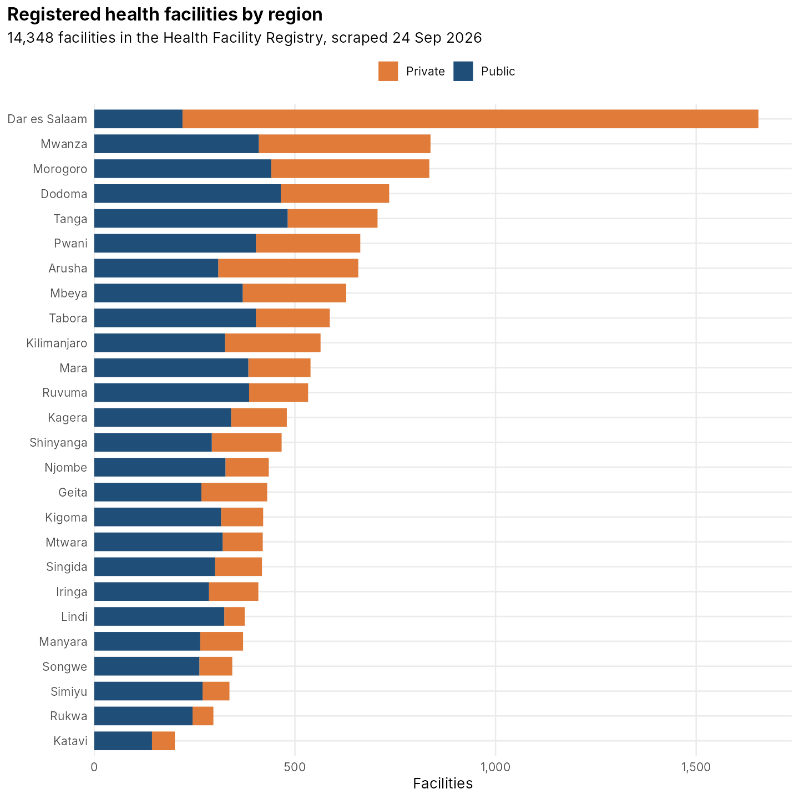
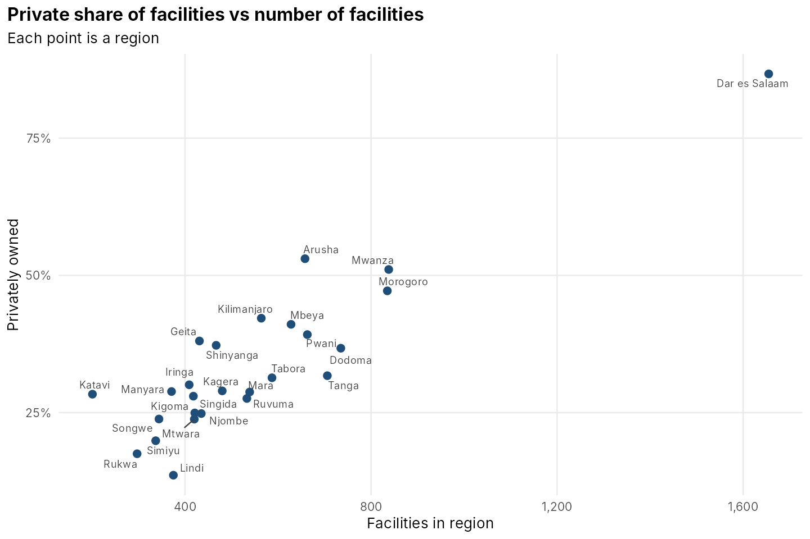
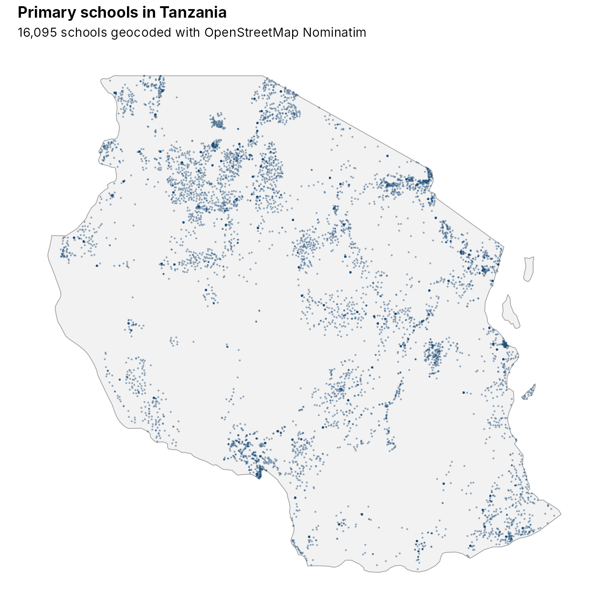
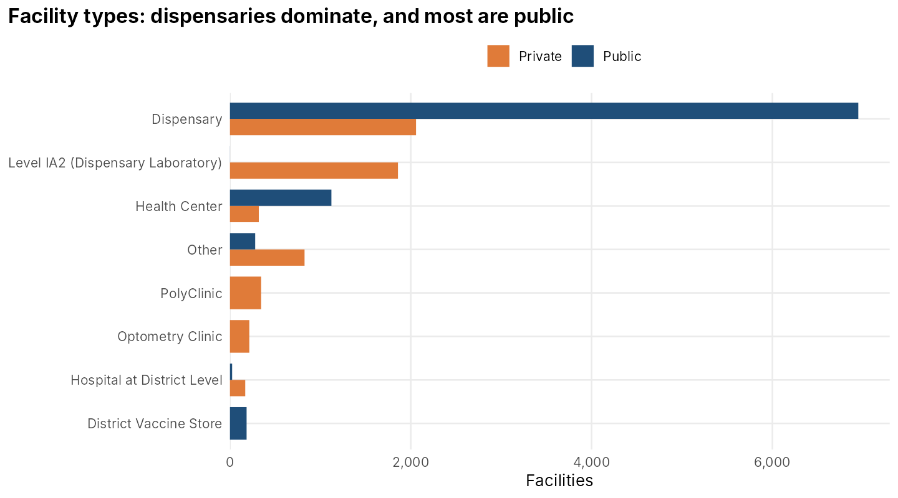
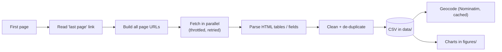

# Tanzania Public Data Scrapers

R (and Python) scrapers that turn Tanzanian public web directories into clean, analysis-ready datasets, with the data and a few charts.

| Dataset | Source | Rows | Scraper |
|---|---|---|---|
| Health facilities | Ministry of Health [Health Facility Registry](https://hfrs.moh.go.tz) | 14,348 | `R/hfrs_scraper.R`, `python/hfrs_async.py` |
| Primary schools (geocoded) | Public school directory (shulezetu.com) + OpenStreetMap | 16,095 | `R/schools_scraper.R`, `R/geocode_nominatim.R` |
| Regions and districts (geocoded) | Public reference list + OpenStreetMap | created when you run the script | `R/regions_districts.R` |



## Why

For health-services research in Tanzania I kept needing the same reference lists: every health facility with its level and ownership, every school, every district with coordinates. None of them was available as a simple download. Choosing study sites (for example, a random sample of public and private hospitals per council) starts with lists like these.

## What the data shows

| | |
|---|---|
|  |  |
| **Dar es Salaam is the outlier:** 87% of its 1,655 facilities are private, against 14% to 53% in every other region. | **16,095 primary schools**, geocoded with OpenStreetMap. |



Overall, 60% of registered facilities are public and 40% private. Dispensaries make up 63% of facilities, and three in four of them are run by local government.

## How the scrapers work

- **Pagination discovered, not hard-coded.** Each scraper reads the "last page" link and builds the page list from it, so it keeps working as the registry grows.
- **Parallel but polite.** `httr2::req_perform_parallel()` with a request-rate throttle, a cap on connections and an honest user agent. The Python version does the same with `asyncio` and a semaphore.
- **Failures retried, not lost.** Each request retries with exponential back-off. Any pages that still fail are re-run in up to three more rounds, and anything left is reported rather than silently dropped.
- **Two-level crawl** for schools: listing pages give links, then each school page is parsed field by field ("School number: …").
- **Geocoding by the rules.** Nominatim allows at most one request per second, so the geocoder throttles to that, identifies itself, and caches every result so no address is looked up twice.
- **Tested offline.** `tests/fixture_server.py` serves small pages with the same HTML structure as the real sites, and `tests/test_scrapers.R` checks that every scraper returns the right rows.



## Run it

R 4.3+ with `httr2` (1.1 or later), `rvest`, `tidyverse`, `ggrepel` and `maps`:

```bash
Rscript R/hfrs_scraper.R         # health facilities  -> data/hfrs_facilities_<date>.csv
Rscript R/schools_scraper.R      # primary schools    -> data/primary_schools_<date>.csv
Rscript R/regions_districts.R    # regions/districts  -> data/regions_districts.csv
Rscript analysis/summaries.R     # charts             -> figures/
```

Python version of the facility scraper:

```bash
pip install -r python/requirements.txt
python python/hfrs_async.py
```

Offline tests:

```bash
python tests/fixture_server.py &          # local copy of the page structures
Rscript tests/test_scrapers.R
```

## Notes

- Everything here is **publicly listed institutional data**: facility and school names, codes, locations and ownership. These scrapers deliberately collect nothing about individuals.
- Geocodes come from OpenStreetMap place names. Where a school isn't on the map, Nominatim returns the nearest named place, so some points sit on town or district centres.
- Web pages change. If a scraper stops working, the selectors at the top of each parse function are the place to look.
- Please keep request rates low. These are public services, not bulk-download APIs.

## License

Code: MIT. See [LICENSE](LICENSE). The data belongs to its original publishers. OpenStreetMap data is © OpenStreetMap contributors (ODbL).
